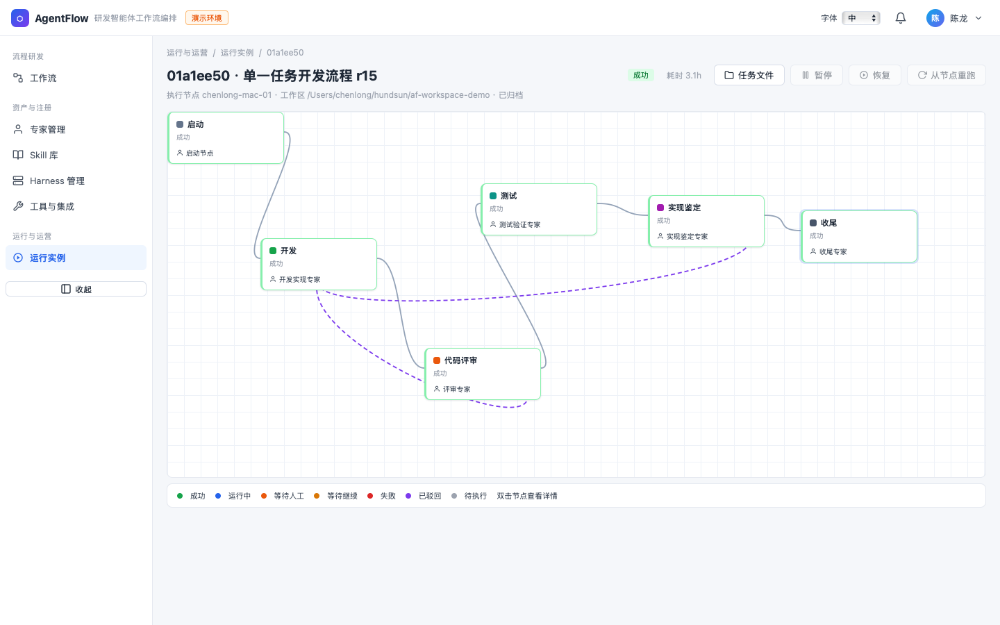

# 结果：资产删除后的运行快照 UI 对接

## 1 结论

运行详情改为优先消费 `RunDetail.graph`，标题用 `RunSummary.workflowName`；有快照时不再请求 `GET /workflows/{id}`。`run.graph` 缺失时才回退旧工作流接口，回退也失败显示「该运行没有可用的图快照」占位，不把详情页置为错误。节点弹层「专家」优先 `RunNodeView.expertName`，专家已删除时显示快照名与中性色圆点，不再显示裸 UUID；无快照且查不到时显示「—」。运行列表与 `?wfId=` 筛选横幅优先 `workflowName`，已删除工作流的运行仍可读。

工作流/专家/Harness 的删除确认框都补充「未结束的运行」说明；409 `referenced` 且 `details.references` 含 `type="run"` 时提示「有未结束的运行正在使用该资产」，列出前 3 个运行 ID，不删除、不自动取消运行。

## 2 落点

| 文件 | 改动 |
|---|---|
| `assets/js/pages/instance-detail.js` | 移除 `state.workflow`；有 `RunDetail.graph` 直接用，缺失才回退 `workflows.get`；标题用 `workflowName`；无图占位与 `paint` 保护 |
| `assets/js/pages/instances.js` | `wfLabel` 优先 `run.workflowName`；`wfNameById` 从历史运行快照取筛选横幅名称 |
| `assets/js/run/node-view.js` | `expertCell(node, runNode, experts)`：`expertName` 优先、其次当前专家列表、最后「—」；中性色圆点 |
| `assets/js/pages/workflow-list.js` | 删除确认补「未结束的运行」与快照说明 |
| `assets/js/pages/experts.js` | 删除确认补「当前工作流或未结束的运行」 |
| `assets/js/pages/harnesses.js` | 删除确认补「工具或未结束的运行」 |
| `assets/js/api.js` | 409 `references` 含 run 时提示未结束运行（B1 专家/Harness 共用） |
| `assets/js/workflow/data.js` | 409 `references` 含 run 时提示未结束运行（工作流共用） |
| `tools/fake-b1.js` | run DTO 补 `workflowName`/`harnessName`/`graph`；删除支持 `_runRefs` 409 夹具 |
| `tools/verify-m1-scenarios.js` | 新增快照/删除引用夹具与 `SCN-0004` T12–T16 |

## 3 验收

| 项 | 结果 |
|---|---|
| `node tools/verify-m1-scenarios.js SCN-0004` | 16/16 通过（T1–T16） |
| `node tools/verify-m1-scenarios.js` | 71/71 通过（全量 M1） |
| `node tools/verify-node-observability.js` | 8/8 通过（SCN-0021 不回归） |
| `npm test` | 通过（退出码 0：语法/风格/文档/索引/依赖/架构/场景追溯/BFF/冒烟/M1/观测/工作流） |
| 真实后端只读走查 | run `01a1ee50…` 标题「单一任务开发流程 r15」、6 个节点来自 `RunDetail.graph`、无 `GET /workflows/{id}` 请求；节点 n3 弹层显示「开发实现专家」、无 UUID、无控制台错误；未执行任何删除/写操作 |

## 4 已知偏差

- `RunDetail.graph` 与回退工作流都缺失时只能显示无图占位，节点弹层不可用；仍可通过页头「任务文件」查看执行产物。这类旧运行本身没有可恢复的图数据。
- 旧后端/旧运行缺 `workflowName`/`expertName`/`graph` 时仍按旧路径回退，回退结果可能随当前资产改名或删除而变化。
- UI 不预检「是否有活跃运行」；删除是否被阻止由后端 409 决定。若后端 409 未带 `details.references`，只显示通用「资产仍被引用」文案。
- 真实后端只做了只读展示走查，未真实删除工作流/专家/Harness；删除成功与 409 分支由 fake B1/B3 覆盖。
- 运行详情副标题仍显示 `clientId`，未改用 `harnessName`（提案标注为可选，本轮未做）。

## 5 结论落点

| 项 | 落点 |
|---|---|
| 需求 | `REQ-0027` → `delivered` |
| 场景 | `SCN-0004` 新增 T12–T16，verified 16/16 |
| 组件 | `CMP-instances`、`CMP-workflow-list`、`CMP-experts`、`CMP-harnesses`、`CMP-run-data`（DTO 消费说明） |
| 代码 | `instance-detail.js`、`instances.js`、`run/node-view.js`、三资产页、`api.js`、`workflow/data.js` |
| 测试 | `tools/fake-b1.js`、`tools/verify-m1-scenarios.js` |
| 文档 | `REQ-0027`、`SCN-0004`、`instances`/`run-data`/`workflow-list`/`experts`/`harnesses` 规格、`architecture.md`、`roadmap.md` |
