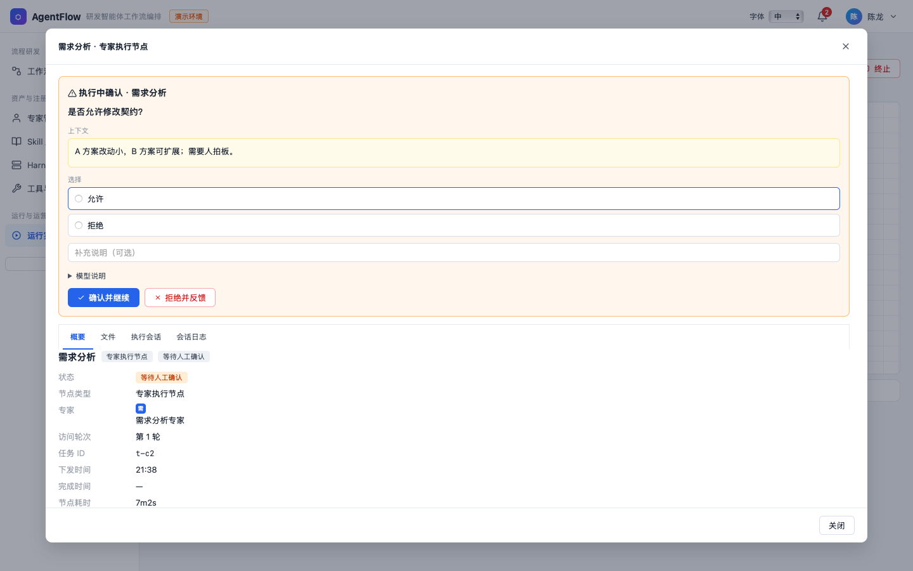
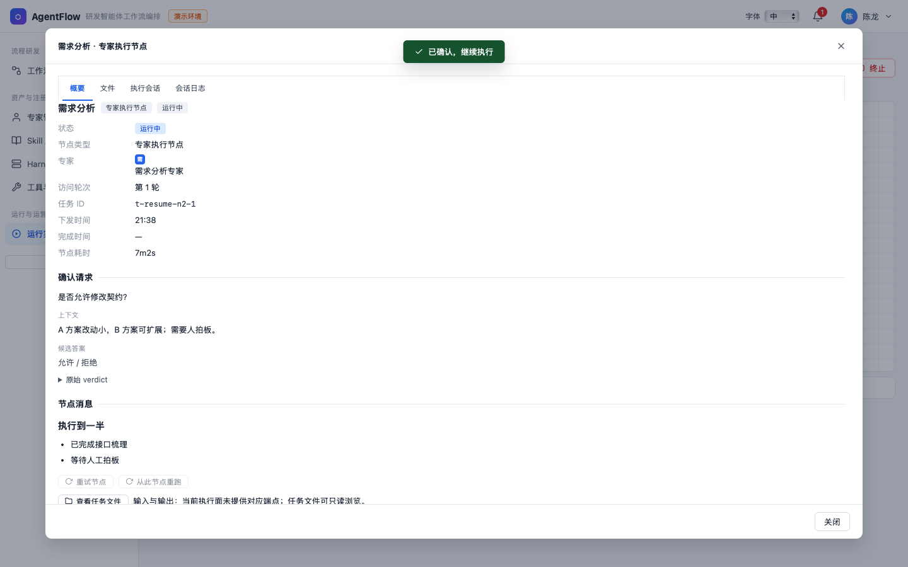

# 结果：执行中确认点 UI 对接

## 1 结论

`waiting_confirm` 现在按 `RunNodeView.verdict.kind` 区分两种来源：`confirm` 节点保持批准/驳回与回退；`confirmation_request` 确认点显示「执行中确认」卡（问题、上下文、候选答案、补充说明、模型说明折叠），提交「确认并继续」或「拒绝并反馈」。选项与补充说明拼成 `comment`，reject 不回退；决策响应直接重绘并保留弹层，节点回 `dispatched`、`taskId` 替换、`visit` 不变。异常 verdict 只读，历史轮不出现确认卡，提交中禁用按钮，409 刷新后不自动重提。

## 2 落点

| 文件 | 改动 |
|---|---|
| `assets/js/run/node-view.js` | `confirmationOf`/`confirmationFromVerdict`/`confirmModeOf`/`confirmKeyOf`/`readDecisionComment`/`decisionToast`；`confirmCard(node, runNode, mode)` 参数化；概要 Tab 结构化展示 question/context/options，原始 verdict 折叠 |
| `assets/js/pages/instance-detail.js` | `resolveModal` 计算 `confirmMode`；按模式重建确认卡；`bindConfirm` 支持 confirm/confirmation/abnormal；决策成功直接用响应 `RunDetail` 重绘；400/404/409/503 映射；提交中防重 |
| `assets/js/run/data.js` | 新增 `decisionErrorText`（400/404/409/503 文案） |
| `pages/instance-detail.html` | 确认点问题/上下文/选项/补充说明/折叠区样式 |
| `tools/fake-b1.js` | 决策端点按 `verdict.kind` 模拟确认点续跑：节点回 `dispatched`、`taskId` 替换、`visit` 不变、run 回 `running`，不推进到 n3 |
| `tools/verify-m1-scenarios.js` | 新增确认点夹具与 `SCN-0022` T1–T8；`confirm` 节点 T5 回归 |
| 文档 | `REQ-0026`、`SCN-0022`、`instances/spec.md` §3.5、`architecture.md`、`roadmap.md` M21、`_index.md` |

## 3 验收

| 项 | 结果 |
|---|---|
| `node tools/verify-m1-scenarios.js SCN-0022` | 8/8 通过（T1–T8） |
| `node tools/verify-m1-scenarios.js SCN-0004` | 11/11 通过（confirm 节点、超时继续不回归） |
| `npm test` | 通过（exit 0：语法/风格/文档/索引/依赖/架构/场景追溯/BFF/冒烟/M1/观测/工作流） |
| `npm run check:docs` | 通过（components 16 / requirements 26 / scenarios 20） |
| `npm run docs:index:check` | 无 diff |
| 视口 | 1440×900 下确认卡与概要完整；900×640 下卡片内容与按钮换行不溢出（页面外壳与轨迹画布本身在 900px 沿用桌面布局的既有横向滚动，不是本次卡片引入） |
| 浏览器错误 | 场景与截图脚本均无 pageerror / console.error |

## 4 已知偏差

- 概要与等待卡的结构化展示依赖 `verdict` 形状；`question` 为空或 `kind` 不符时只读提示，不猜测、不提交。
- 决策成功后不展示「用户选了哪个选项」：后端响应只保留原始 `confirmation_request` verdict 与节点状态，选择结果在续跑 prompt 中，UI 不自行推断。
- review verdict 的 `evidence` 数组未做列表化（上游提案标注为「建议但不必需」），继续按原 JSON 展示。
- 真实后端当前没有 `waiting_confirm` 运行（`GET /runs?state=waiting_confirm` 返回 0），未做真实确认卡的只读走查；确认卡形状按上游 `result.md` 的联调记录与 fake B1 覆盖，避免为验证新建 run 并消耗模型 token。
- 本工序与并行完成的超时继续执行工序共用 `instance-detail.js`/`node-view.js`/`fake-b1.js`/`verify-m1-scenarios.js`；两套功能各自有场景覆盖，最终工作树包含两者，未提交。

## 5 结论落点

| 项 | 落点 |
|---|---|
| 需求 | `REQ-0026` → `delivered` |
| 场景 | `SCN-0022` verified 8/8；`SCN-0004` 保持 11/11 |
| 组件 | `CMP-instances`、`CMP-run-data` |
| 代码 | `assets/js/run/node-view.js`、`assets/js/pages/instance-detail.js`、`assets/js/run/data.js`、`pages/instance-detail.html` |
| 测试 | `tools/fake-b1.js`、`tools/verify-m1-scenarios.js` |
| 文档 | `REQ-0026`、`SCN-0022`、`instances/spec.md`、`architecture.md`、`roadmap.md`、`docs/design/scenarios/_index.md` |
