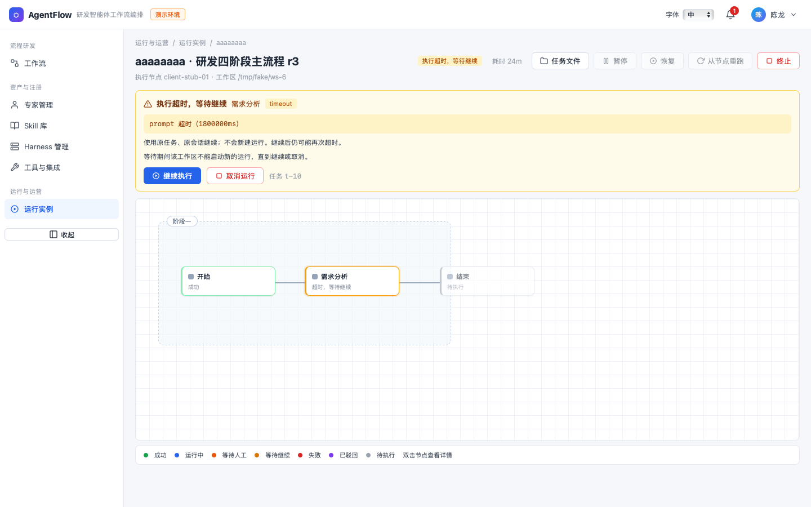
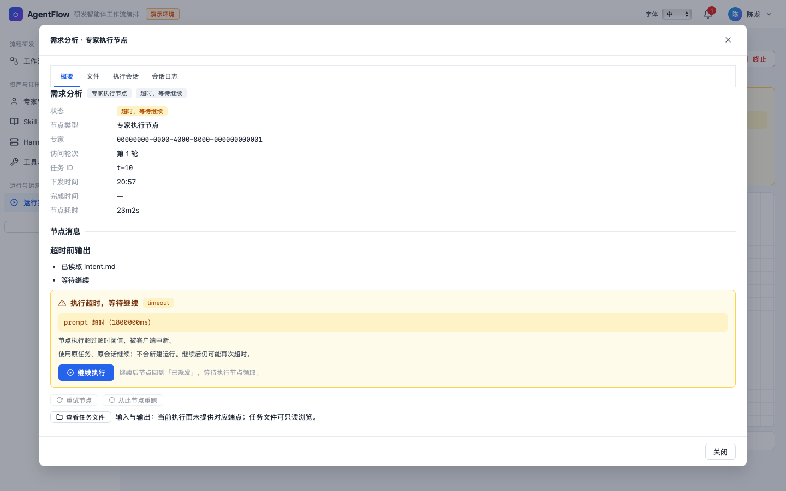
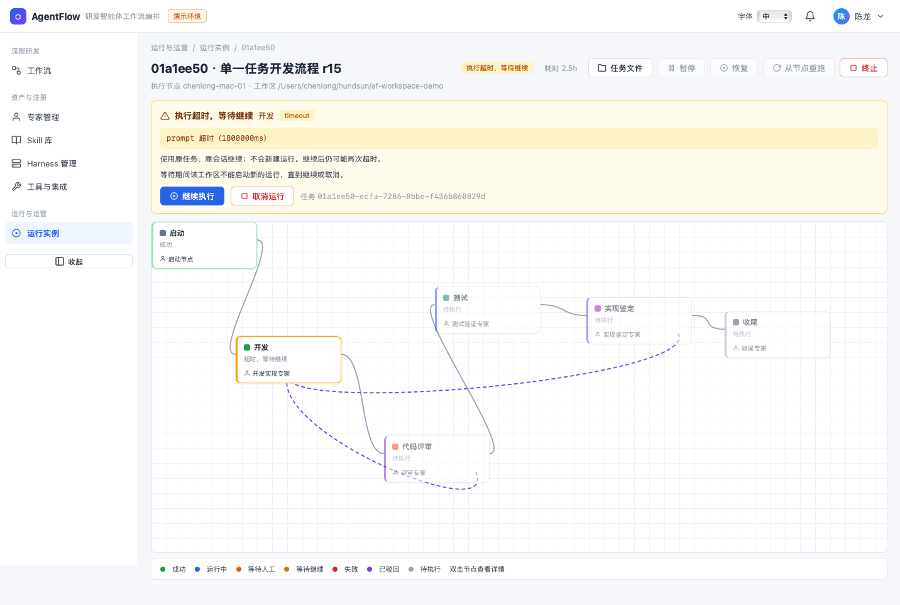
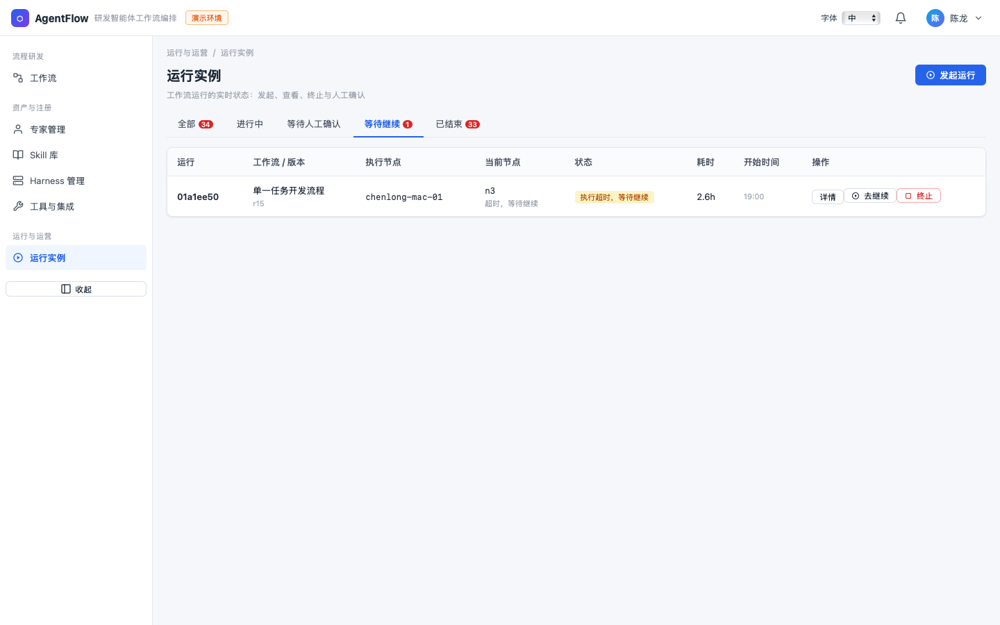

# 结果：超时节点继续执行 UI 对接

## 1 结论

`waiting_resume` 已接入运行实例两页：列表新增「等待继续」Tab 与「去继续」；详情在轨迹上方显示等待横幅（节点名、超时码、错误信息、两条提示、「继续执行」「取消运行」），最新轮等待节点弹层出现同款继续卡；续跑调用无请求体的 `POST /runs/{id}/nodes/{nodeId}/resume`，请求期间禁用按钮，`200` 后 run 回 `running`、节点回 `dispatched`、同一 `taskId` 保留，`409` 按 `details.reason` 提示并刷新，`503` 保留按钮，`404` 返回列表。后端未改，UI 不展示 `sessionId`/`attempt`，不新建 run/task。

## 2 落点

| 文件 | 改动 |
|---|---|
| `assets/js/run/data.js` | `RUN_STATE`/`NODE_STATE`/`ACTIVE_STATES` 增加 `waiting_resume`；新增 `resumeNode(runId,nodeId)`；409 `details.reason` 文案映射 |
| `assets/js/run/node-meta.js` | 新增等待继续的节点样式类与 amber 状态点 |
| `assets/js/run/node-view.js` | 等待继续节点状态色、`resumeNotice` 等待卡（超时说明 + 继续按钮） |
| `assets/js/pages/instance-detail.js` | 运行级等待横幅、按钮 loading/禁用、续跑成功/409/503/404 处理、5s 轮询覆盖等待态、节点弹层继续入口 |
| `assets/js/pages/instances.js` | 新增「等待继续」Tab、状态标签、当前节点副文案、「去继续」行操作 |
| `pages/instance-detail.html` | 等待横幅与等待卡样式（复用 `DF` 按钮/标签/tag） |
| `assets/css/main.css` | `.tag.amber`、`.dot.amber`、`.cv-node.st-timeout` |
| `.oxlintrc.json` | `instance-detail.js` 加入既有大页面 `max-lines` 例外（本轮新增约 87 行后 650 行） |
| `tools/fake-b1.js` | 新增 `waiting_resume` 运行夹具、`resume` 端点与 409/503/延迟注入 |
| `tools/verify-m1-scenarios.js` | T1 计数更新（5 行/5 Tab）；新增 T9 正例、T10/T11 反例 |

## 3 验收

| 项 | 结果 |
|---|---|
| `node tools/verify-m1-scenarios.js SCN-0004` | 11/11 通过（T1–T11） |
| `node tools/verify-m1-scenarios.js` | 58/58 通过（全量 M1 场景） |
| `node tools/verify-node-observability.js` | 8/8 通过（SCN-0021 不回归） |
| `npm test` | 通过（语法/风格/文档/依赖/架构/场景追溯/BFF/冒烟/M1/观测/工作流） |
| 视口走查 | 1440×900 横幅与等待卡完整；900×640 横幅按钮/提示自动换行、不溢出（页面整体仍为桌面布局）；390×844 未做移动端适配，页面横向布局沿用现状 |
| 真实后端 | 只读走查通过：`http://127.0.0.1:3000`（BFF → `127.0.0.1:3100`）打开 run `01a1ee50-cd00-7745-be97-333f7c25c03f`，横幅显示「开发 / timeout / prompt 超时（1800000ms）」与 task，节点为 `st-timeout`，列表「等待继续」Tab 查得 1 条，无控制台错误；未点击「继续执行」，避免触发真实续跑与 token 消耗 |
| 续跑成功路径 | 由 fake B1 覆盖（同一 taskId、节点回 `dispatched`、run 回 `running`）；真实端点调用留在有 client 在线时人工联调 |

## 4 已知偏差

- 上游提案写「当前节点卡片」，本仓库为「轨迹图 + 双击节点 90% 弹层」，因此运行级操作落在轨迹上方横幅，节点级操作落在最新轮弹层等待卡；两处共用同一个续跑处理。
- 列表「去继续」只跳详情，不自动打开节点弹层；详情横幅是主要入口。
- 等待横幅与页头「终止」同时存在（页头保留非终态统一终止入口，横幅提供等待期就近操作）。
- 未新增 TTL、续跑次数上限、给模型留言、SSE 或 sessionId/attempt 展示（与提案边界一致）。
- 真实后端只读展示已验证，但真实续跑端点未点击（需要 client 在线并会消耗 token）；续跑成功路径由 fake B1 覆盖。
- `assets/js/run/node-view.js` 在本轮同时包含另一处未提交的确认点（`confirmation_request`）改动；本轮未改动该部分，SCN-0004/0021 回归未受影响。

## 5 结论落点

| 项 | 落点 |
|---|---|
| 需求 | `REQ-0025` → `delivered` |
| 场景 | `SCN-0004` 新增 T9–T11，verified 11/11 |
| 组件 | `CMP-run-data`（端点/词表）、`CMP-instances`（列表/详情/弹层） |
| 代码 | `assets/js/run/*`、`assets/js/pages/instances.js`、`assets/js/pages/instance-detail.js`、`pages/instance-detail.html`、`assets/css/main.css` |
| 测试 | `tools/fake-b1.js`、`tools/verify-m1-scenarios.js` |
| 文档 | `REQ-0025`、`SCN-0004`、`run-data`/`instances` 规格、`architecture.md`、`roadmap.md` |
