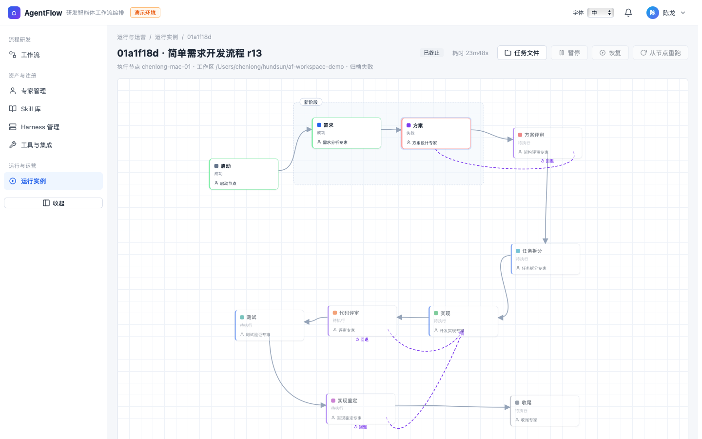

# 结果：运行轨迹图与编辑器画布同源

## 1 结论

连线几何下沉到 `assets/js/shared/canvas-geometry.js`：节点尺寸、四向锚点、自动选边、同节点进出锚点错开、seq/rollback 曲线、箭头 marker、回退标签位置与视口 transform 只有一份实现。编辑器与运行详情都改用它：

- 编辑器 `edgeSvg` 的连线输出逐字不变（基准 `d` 锁定），选中、hit 热区、拖拽预览、错误红框仍由编辑器视图组装。
- 运行详情按保存的 `node.layout.inSide/outSide` 与 `graph.viewport` 画线：seq 灰色箭头、rollback 紫色虚线 + 紫色箭头 + 「↺ 回退」；`#cvScaler` 套用 `translate(x,y) scale(zoom)`，与编辑器一致。

同一份 10 节点 / 12 条边的工作流，改造前两套渲染器 9 条边路径不同、运行页无箭头；改造后 5 条夹具边与编辑器逐字一致，真实工作流的连线也按保存锚点走线。

## 2 落点

| 文件 | 改动 |
|---|---|
| `assets/js/shared/canvas-geometry.js` | 新增：画布几何、箭头定义、回退标签位置、视口 transform 的纯函数 |
| `assets/js/workflow/views/canvas.js` | 删除本地几何，改用共享函数；保留阶段/节点 HTML、选中/hit/预览/错误标记 |
| `assets/js/workflow/model.js` | `NODE_SIDES` 改为从共享几何转出（单一来源） |
| `assets/js/pages/workflow-editor.js` | 几何 import 改到共享层；视口 transform 用 `viewportTransform` |
| `assets/js/run/views/run-canvas.js` | 用共享几何画边、加箭头/回退标签；节点 HTML 与状态着色不变 |
| `assets/js/pages/instance-detail.js` | 画布加 `#cvScaler` 包裹层并传入 `paintCanvas` |
| `pages/instance-detail.html` | `#cvScaler{transform-origin:0 0}` |
| `tests/shared/canvas-geometry.test.js` | 新增 7 条纯几何单测 |
| `tests/workflow/canvas.test.js` | 新增 3 条编辑器视图回归（含 golden `d`） |
| `tools/fake-b3.js` | 新增 `addWorkflow` 测试注入 |
| `tools/verify-m1-scenarios.js` | 新增 `SCN-0023` T1–T4 与 TRACE 夹具 |

## 3 验收

| 项 | 结果 |
|---|---|
| `node tools/verify-m1-scenarios.js SCN-0023` | 4/4 通过（跨页连线逐字一致、箭头/虚线/回退标签、保存视口、非法视口回落） |
| `node tools/verify-workflow-editor.js` | 24/24 通过（SCN-0019 编辑器连线/选边/箭头回归） |
| `node tools/verify-m1-scenarios.js SCN-0004` | 16/16 通过（运行详情/列表不回归） |
| `node tools/verify-m1-scenarios.js SCN-0022` | 8/8 通过（执行中确认点不回归） |
| `node --test tests/shared tests/workflow` | 53/53 通过 |
| `node tools/verify-m1-scenarios.js`（全量） | 75/75 通过（含 SCN-0023 4 条） |
| `npm run test:smoke` | 13/13 页面结构冒烟通过 |
| `npm run test:observability` | 8/8 通过（SCN-0021 不回归） |
| `npm run test:mock-pages` | 22/22 通过（演示页门禁不回归） |
| `npm run check:syntax` / `check:style` | 通过（oxlint 0 warning） |
| `npm run test:gate` | 通过（语法/风格/文档/索引/依赖/架构/场景追溯/单测/BFF） |
| 真实数据对照 | 后端 `简单需求开发流程` r13（10 节点/12 边）：改造前运行页 9/12 条边与编辑器不同、0 箭头；改造后共享几何同时服务两页 |

## 4 已知偏差

- 用户提供的 runId `01a1f407-d79c-741c-ad10-584c66faca23` 在当前后端返回 404（`run_not_found`，运行列表 39 条中无此 ID），未做该单例的现场核对；按夹具与真实工作流图完成通用修复。
- 运行页只套用保存视口，不提供缩放/平移控件；保存视口较大或偏移时，内容可能落在画布滚动区外，需要滚动查看。
- 运行图仍是启动时冻结的 `RunDetail.graph`（`REQ-0027`），工作流在运行后保存的新节点/新连线不会出现在旧运行里；本轮没有加「当前工作流已更新」提示。
- 共享几何不校验锚点枚举，非法值由 `toEditorGraph` 归一为 `null`；直接绕过 `toEditorGraph` 传原始图不在支持范围。
- `npm test` 的子命令已分别执行且全绿（`test:gate`、shared、bff、smoke、mock-pages、全量 M1、observability、workflow），未串联再跑一次 `npm test`；未跑真实 B1 读写脚本（会写真实测试数据）。

## 5 结论落点

| 项 | 落点 |
|---|---|
| 需求 | `REQ-0028` → `delivered` |
| 场景 | `SCN-0023` 新建并 verified 4/4；`SCN-0019` 回归 24/24 |
| 组件 | `CMP-instances`、`CMP-workflow-editor`；共享模块 `shared/canvas-geometry` |
| 决策 | `history/decisions/2026-11-19-shared-canvas-geometry.md` |
| 文档 | `architecture.md`、`instances`/`workflow-editor` 规格、`roadmap.md`（M23） |
