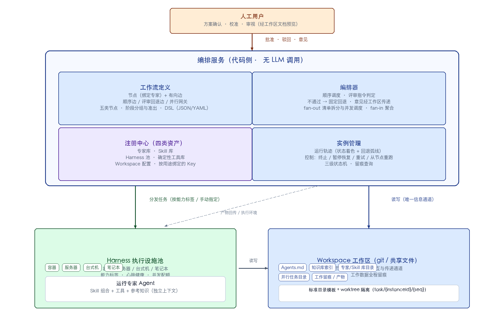
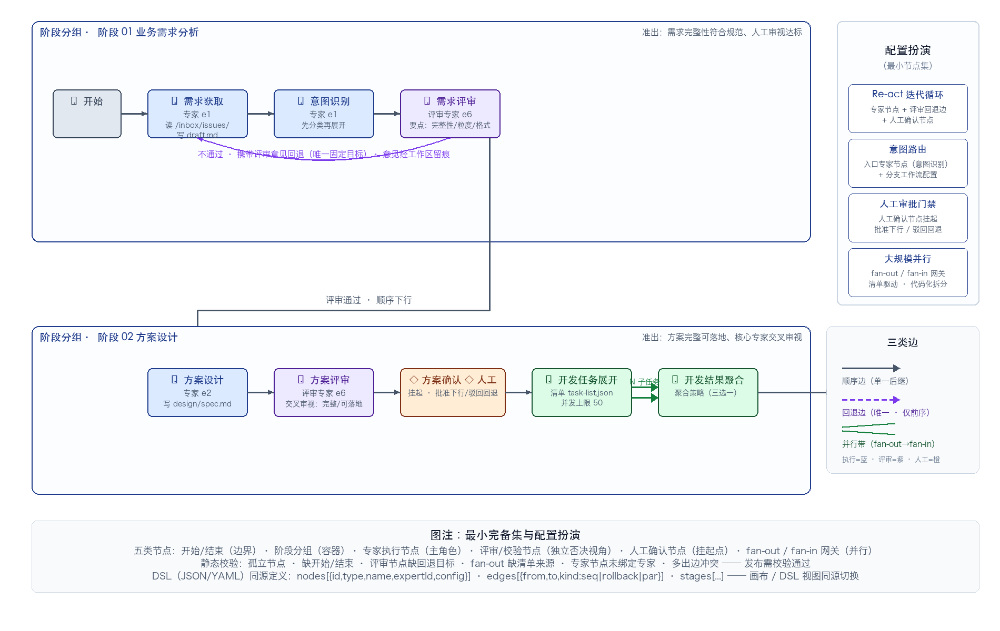
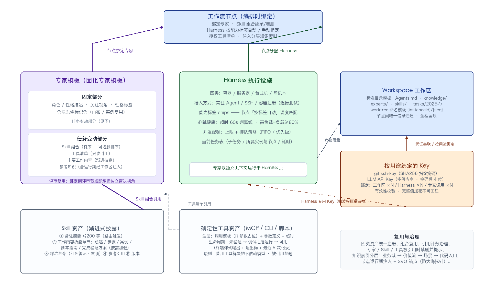
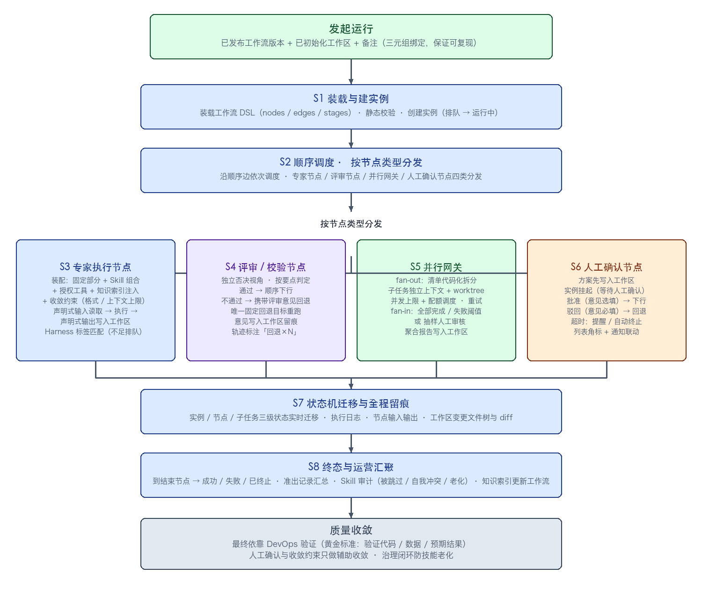
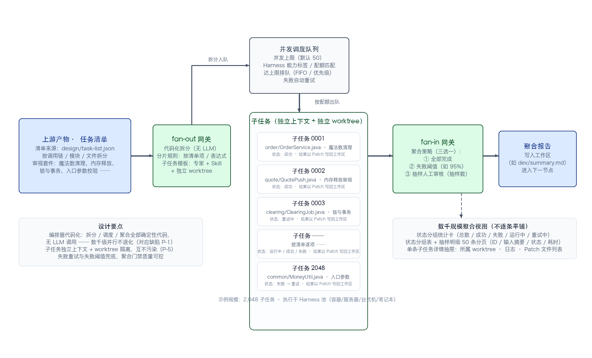
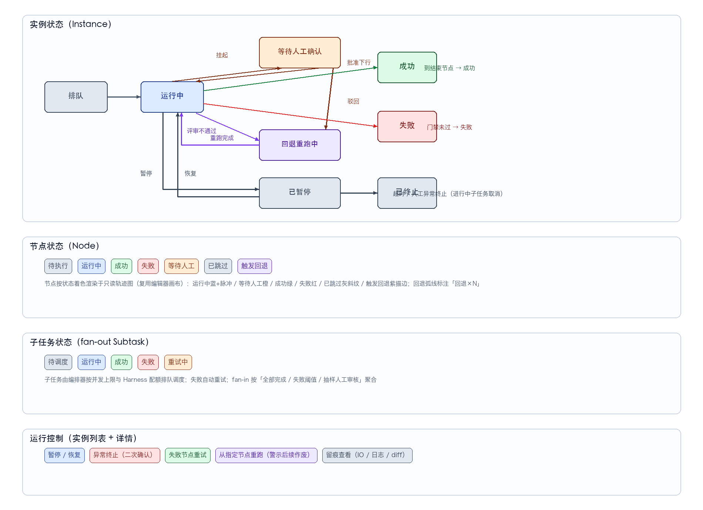

# 专利技术交底书

> 项目：AgentFlow · 研发智能体工作流编排　|　版本：v1.0（整理稿）
> 资料来源：`docs/design/` 现行设计真相（product / workflow-editor / workflow-list / instances / experts / skills / harnesses / tools / workspaces / keys / analytics / ui-shell）+ 原始概念资料 `reference/workflow_concept.pptx`（P1–P8）
> 密级：内部资料，请勿外传

---

## 1 · 发明名称

**一种基于代码化编排与工作区唯一信道的研发智能体系统及其工作流处理方法**

（英文名参考：AgentFlow — An R&D Agent System with Code-based Orchestration and Workspace-mediated Context Isolation）

---

## 2 · 技术领域

本发明涉及智能软件工程与人工智能应用技术领域，具体涉及一种面向软件研发全流程（需求分析、方案设计、开发测试、集成验证）的多智能体（Multi-Agent）编排系统，尤其涉及一种由无大模型参与的代码化编排器驱动、以工作区为唯一信息信道、以资产化注册（专家/技能/执行设施/工具）为基础的研发智能体工作流系统及其工作流处理方法。

---

## 3 · 背景技术

### 3.1 现有技术方案

随着大语言模型（LLM）能力的发展，业界出现了多种将 LLM 应用于软件研发流程的技术方案，主要包括：

**方案 A：以 LLM 作为编排器的多智能体系统。** 系统中设置一个由 LLM 充当的"编排智能体"或"调度智能体"，由其理解任务、拆分子任务、分配给下游执行智能体，并依据 LLM 输出的中间结果动态决定下一步操作。典型形态如基于提示工程构建的多角色对话协作框架。

**方案 B：单智能体 Re-act（推理-行动）自主循环。** 单个智能体在统一上下文中按"计划→执行→审视"循环自主推进，循环的继续、终止与跳转均由模型决策。复杂任务被期望通过更长的上下文和更多的工具调用完成。

**方案 C：传统 CI/CD 流水线。** 以确定性脚本组织构建、测试、部署等环节，流程固定、结果可复现，但只能处理预定义的结构化步骤，无法处理需求理解、方案设计、代码审视等非结构化研发任务。

**方案 D：智能体间消息直传的协作方式。** 多个智能体通过会话消息互相传递中间结果，各自维护或共享对话上下文。

### 3.2 现有技术存在的问题

本发明在长期工程实践中发现上述方案存在以下缺陷（对应原始概念资料 P3/P4/P5 记录的真实踩坑）：

| # | 缺陷 | 具体表现 |
|---|---|---|
| P-1 | **LLM 编排退化** | 以 LLM 作为调度协调者执行仓库级、构建级的大批量并行任务时，出现调度退化、上下文失衡、目标丢失等磨损；数千规模并行任务时尤为严重；且 token 成本高昂、行为不可复现 |
| P-2 | **单智能体循环不稳定** | 简单任务可以跑通，复杂任务运行不稳定：模型不能严格按照技能（Skill）中编写的步骤顺序执行，存在跳步、因上下文焦虑而省略等问题；约束规范、禁令无法 100% 遵守 |
| P-3 | **技能老化与自我冲突** | 通过交互式沉淀更新技能之后，解决措施、禁令方案等会重复、自我冲突，导致技能弱化，缺乏可运营的治理机制 |
| P-4 | **知识库检索退化** | 随着项目进展知识库不断膨胀，模型对积累的知识开始遗忘、找不到；金融证券等业务规则细杂（交易所规则、监管规则、券商运营规则交织），模型如同新人每次从头探索，产生"大海捞针"式执行与发散乱猜 |
| P-5 | **上下文污染与留痕缺失** | 智能体间以消息直传或共享对话上下文协作时，彼此上下文互相污染；中间过程与工作数据不留痕，无法审计、无法回溯、无法支撑大规模并行 |
| P-6 | **人工协同在流程之外** | 方案确认、人工校准等环节游离于流程之外，流程无法在人工节点处挂起/恢复，整体进度与状态不可见 |
| P-7 | **流程表达能力与建模成本矛盾** | 若为 Re-act 循环、意图路由、CI/CD 触发等每种控制语义均设置专门节点，节点类型膨胀、图模型验证困难；若不设置，又缺乏表达手段 |

因此，亟需一种既能承载非结构化研发任务、又具备确定性大规模调度能力，且上下文隔离、过程留痕、人机协同、知识可运营的研发智能体系统。

---

## 4 · 发明目的

针对现有技术的上述缺陷，本发明的目的在于提供一种研发智能体系统及其工作流处理方法，达到：

1. **编排确定性**：编排器完全代码化（无 LLM 参与），顺序调度、回退控制、大规模并行拆分与聚合、状态机管理均由确定性代码执行，解决 LLM 编排退化问题，支持数千级子任务并行；
2. **上下文隔离与留痕**：所有智能体节点的执行上下文彼此独立，节点间以工作区（git 仓库/共享文件）为**唯一**信息交互通道，工作数据全程留痕、可审计、可回溯；
3. **质量收敛**：以"评审节点 + 固定回退边"在流程内表达迭代循环，评审节点以独立否决视角输出指令，不通过时携带评审意见回退到预设固定目标重跑，最终收敛依靠确定性验证（DevOps 黄金标准），人工与约束只做辅助收敛；
4. **最小节点集表达复杂控制**：仅用五类节点和三类边即表达顺序、迭代循环（Re-act 语义）、意图分流、人工挂起、大规模并行等复杂控制语义，降低建模与验证成本；
5. **资产化复用**：专家、技能（Skill）、执行设施（Harness）、确定性工具四类资产统一注册、组合复用，专家模板区分固定部分与任务变动部分，Skill 采用渐进式披露结构；
6. **知识可运营**：节点级配置分层知识索引注入（业务域→价值流→场景→代码入口）与收敛约束，防止大海捞针；效能看板汇聚准出记录与 Skill 审计（被跳过/自我冲突/老化），形成知识索引与技能更新的治理闭环；
7. **人机协同流程内闭环**：人工确认节点承载方案确认与人工校准，实例在该类节点挂起，批准后继续、驳回后按预设边回退，进度状态全程可视。

---

## 5 · 术语定义

| 术语 | 定义 |
|---|---|
| 编排器（Orchestrator） | 代码侧调度执行体，**不包含 LLM 调用**：负责顺序调度、评审指令判定、回退控制、fan-out/fan-in 大规模并行调度、实例状态机管理与工作数据留痕 |
| 专家（Expert） | 以独立上下文执行的智能体模板 = 固定部分（角色/性格描述）+ 任务变动部分（Skill 组合 + 工具清单 + 主要工作内容 + 参考知识） |
| 技能（Skill） | 独立沉淀的能力单元：名称、常驻摘要（Description，供模型路由触发）、渐进披露的工作内容、踩坑禁令、参考引用、版本 |
| 执行设施（Harness） | 智能体实际运行处（笔记本/台式机/服务器/容器），提供工具、MCP CLI、代码检索等执行环境，带能力标签、心跳健康与并发配额 |
| 工具（MCP/CLI） | 独立注册的确定性工具资产（调用链分析、Linter、DSL 检索、元数据查询、造数工具等），被专家/Skill 引用，由 Harness 承载运行 |
| 工作区（Workspace） | git 仓库或共享文件构成的任务工作集合，是节点间**唯一**的信息交互与传递通道，并承担工作数据留痕 |
| 工作流（Workflow） | 节点 + 有向边的流程定义模板（可复用、可发布版本） |
| 实例（Instance） | 工作流的一次运行，含节点运行轨迹、子任务、留痕与控制操作 |
| 评审回退（Loop-back） | 评审/校验节点不通过时，回到其唯一预设回退目标节点重跑，评审意见经工作区留痕传递 |
| fan-out / fan-in | 清单驱动的并行展开与聚合网关 |
| 人工确认节点 | 流程内等待人工批准/驳回的挂起点，承载「方案确认」「人工校准」 |
| 上下文与收敛配置 | 节点级的知识索引注入、收敛约束（格式规范/上下文上限）与工具使用权限配置 |
| 黄金标准 | DevOps 验证代码、验证数据与预期结果构成的确定性收敛基准 |

---

## 6 · 技术方案

### 6.1 系统总体架构

系统整体分为四层（对应交付形态的导航分组）：

```
人工用户（方案确认 / 校准 / 审视）
     │ 批准·驳回·意见
     ▼
┌───────────────── 编排服务（代码侧，无 LLM）─────────────────┐
│  工作流定义：节点（绑定专家）+ 边（顺序/回退/并行网关）          │
│  编排器：顺序调度 · 评审指令判定（通过→下行 / 不通过→固定回退）   │
│          fan-out 清单拆分与并发调度 · fan-in 聚合 · 状态机管理   │
│  注册中心：专家库 · Skill 库 · Harness 池 · 工具库 ·            │
│            Workspace 配置 · Key                                │
│  实例管理：运行轨迹 · 控制（终止/暂停/重试/重跑）· 留痕查询       │
└───────────────┬──────────────────────────┬─────────────────┘
                ▼ 分发任务                   ▼ 读写（唯一信息通道）
┌────────────────────────┐   ┌─────────────────────────────────┐
│  Harness 执行设施池      │   │  Workspace 工作区（git/共享文件）  │
│  容器 / 服务器 /         │   │  Agents.md · 知识库索引 ·          │
│  台式机 / 笔记本         │──▶│  任务工作目录（多 Agent 并行）·      │
│  运行专家 Agent：        │   │  工作留痕 / 产物                    │
│  Skill 组合 + 工具 +     │   └─────────────────────────────────┘
│  参考知识（独立上下文）    │
└────────────────────────┘
```



**图1 系统总体架构**

各层职责：

| 层 | 组成 | 职责 |
|---|---|---|
| 流程研发层 | 工作流列表、工作流编辑器（拖拽画布 + 只读 DSL 视图） | 以「节点 + 有向边」维护流程定义，节点绑定专家并配置上下文与收敛约束；静态校验；发布版本 |
| 资产与注册层 | 专家管理、Skill 库、Harness 管理、工具与集成 | 四类资产的注册、组合、健康监控与引用关系管理 |
| 运行与运营层 | 运行实例（列表 + 详情）、效能看板 | 实例轨迹可视化与控制操作；效能指标、评审准出记录汇总、Skill 审计 |
| 基础配置层 | 工作区配置、个人 Key 管理 | 仓库绑定、worktree 策略、目录模板初始化、凭证按用途绑定 |

### 6.2 架构原则（区别于现有技术的四项根本约定）

1. **编排器代码化**：能用工具解决的不依赖模型；路由、意图识别、范围圈定、大规模调度全部由确定性代码承担，算力友好（避免让模型执行大海捞针式任务）。编排器无 LLM 调用，行为可复现、成本可预估；
2. **执行侧智能体化**：Agent 的实际执行由注册到系统、运行在 Harness 上的专家完成；每个专家以**独立上下文**执行，上下文之间不共享对话；
3. **工作区唯一信道**：Workspace（git 仓库/共享文件）是节点间唯一的信息交互与传递通道，并承担工作数据留痕；上下文隔离与信息传递解耦；
4. **资产化注册**：专家/Skill/Harness/工具均为独立注册资产，通过组合引用复用；专家模板固化为「固定部分 + 任务变动部分」。

### 6.3 工作流定义模型：五类节点与三类边

#### 6.3.1 节点类型（五类）

| 节点类型 | 关键配置 | 出边规则 |
|---|---|---|
| 开始 / 结束 | — | 流程边界 |
| 阶段分组 | 阶段名（如需求分析/方案设计/开发测试/集成验证）、阶段准出说明 | 容器，组织子节点 |
| 专家执行节点 | 绑定专家；Skill 组合（默认继承专家，可增删排序）；Harness 分配（按能力标签自动 / 手动指定）；输入说明（读取工作区哪些路径）；输出约定（写入哪些路径/产物）；「上下文与收敛」配置（见 §6.4） | 顺序边 ×1（单一后继） |
| 评审/校验节点 | 绑定评审专家（独立否决视角）；评审要点；**固定回退目标节点（唯一）** | 通过 → 顺序边；不通过 → 回退边（固定目标） |
| 人工确认节点 | 确认事项/方案说明（Agent 先将方案写入工作区，人工在实例详情查看）；方案模板路径；超时策略（不超时/超时提醒/超时自动终止） | 批准 → 顺序边；驳回 → 固定驳回回退边 |
| fan-out 网关 | 任务清单来源（上游节点 + 产物路径，如按调用链/模块/文件拆分）；分片规则；并发上限；子任务模板（绑定专家 + Skill + 独立 worktree/任务目录） | 展开为 N 个子任务 → fan-in |
| fan-in 网关 | 聚合策略（全部完成 / 失败阈值 / 抽样人工审核）；汇聚产物写入路径 | 顺序边 ×1 |

#### 6.3.2 边类型（三类）

| 边 | 语义 |
|---|---|
| 顺序边 | 实线箭头；专家/人工/开始节点仅 1 条出边，重复连线提示替换 |
| 评审回退边 | 紫色虚线弧；从评审节点「回退端口」连至**任意前序节点**，每评审节点唯一，重新连线需确认替换 |
| 并行边 | fan-out→子任务→fan-in 用双线示意并行带 |

#### 6.3.3 「配置扮演」设计（最小节点集的关键）

本发明**不设** Re-act 循环节点、意图路由节点与 CI/CD 触发节点，复杂控制语义全部由既有节点与边的配置组合扮演：

| 控制语义 | 表达方式 |
|---|---|
| 迭代循环（Re-act 语义） | 专家执行节点 + 评审回退边 + 人工确认节点：计划–执行–审视骨架由「阶段内专家节点顺序执行 → 评审节点判定 → 不通过携带意见回退」的流程配置表达 |
| 意图路由 | 入口专家节点（意图识别）+ 不同分支工作流配置：入口专家完成初步分类后，按分支工作流承接 |
| 人工审批门禁 | 人工确认节点挂起 + 批准/驳回 |
| 大规模并行 | fan-out/fan-in 网关 |

由此，节点类型保持五类最小完备集，图模型的静态校验规则随之收敛（见 §6.3.5）。

#### 6.3.4 工作流 DSL 数据结构

工作流定义以结构化 DSL（JSON/YAML）表示，编辑器画布与 DSL 视图同源（画布/DSL 顶栏平级切换，DSL 只读预览 + 导出）：

```json
{
  "nodes": [
    { "id": "n8", "type": "fanout", "name": "开发任务展开",
      "config": { "sourceNode": "n6", "sourcePath": "design/task-list.json",
                  "shard": "按清单项", "maxConc": 50,
                  "subExpert": "e3", "subSkills": ["sk-cres", "sk-ldp"], "worktree": true } },
    { "id": "n2", "type": "agent", "name": "需求获取",
      "expertId": "e1",
      "config": { "input": "workspace:/inbox/issues/",
                  "output": "requirements/draft.md",
                  "ctx": { "knowledge": ["金融证券交易/交易执行/订单提交"],
                           "constraint": "需求描述必须可实施到功能点级",
                           "maxCtx": 32000, "tools": ["t-btree", "t-meta"] } } },
    { "id": "n4", "type": "review", "name": "需求评审",
      "expertId": "e6",
      "config": { "points": "需求完整性、可实施粒度、格式规范",
                  "rollbackTo": "n2",
                  "passNote": "通过 → 进入方案设计",
                  "failNote": "不通过 → 携带意见回退需求获取" } }
  ],
  "edges": [
    { "from": "n3", "to": "n4", "kind": "seq" },
    { "from": "n4", "to": "n2", "kind": "rollback" },
    { "from": "n8", "to": "n9", "kind": "par" }
  ],
  "stages": [
    { "id": "s1", "name": "阶段 01 · 业务需求分析",
      "note": "准出：需求完整性符合规范、人工审视达标" }
  ]
}
```



**图2 工作流定义模型（五类节点 + 三类边 + 阶段分组）**

#### 6.3.5 静态校验规则

编辑器保存/发布前执行图校验，错误面板可点击定位：孤立节点；缺少开始/结束；评审节点缺回退目标；fan-out 缺清单来源；专家节点未绑定专家；多出边冲突。发布需校验通过（版本号 +0.1）。

### 6.4 节点级「上下文与收敛」配置

专家执行节点与评审节点通用的配置分组，用于在给定范围内约束模型执行（防大海捞针、防发散、防上下文超限）：

| 配置项 | 内容 | 作用 |
|---|---|---|
| 知识索引注入 | 分层知识索引范围：业务域 → 价值流 → 场景 → 代码入口（级联多选）+ SVO 锚点输入 | 圈定知识范围，防止大海捞针与发散乱猜 |
| 收敛约束 | 格式规范（文本）、上下文长度上限（token 数） | 约束输出格式与上下文规模 |
| 工具使用权限 | 限定该节点允许调用的 MCP/CLI 工具清单（引用工具注册中心资产） | 最小权限，节点只授予必需工具 |

### 6.5 资产注册体系



**图5 资产注册体系（专家/Skill/Harness/工具/工作区/Key 的引用关系）**

#### 6.5.1 专家模板（固化专家模板）

专家 = 以独立上下文执行的智能体模板，分五区维护：

| 区块 | 内容 | 说明 |
|---|---|---|
| ① 角色描述 | 职责范围、性格描述、关注视角（含性格标签 chips） | **固定部分**：个性偏好、参考描述、角色资料 |
| ② Skill 组合 | 有序 Skill 列表（可拖拽排序），从 Skill 库多选添加/移除 | **任务变动部分**：技能配合顺序即执行顺序 |
| ③ 工具清单 | 引用工具注册中心资产（工具名 + 类型 + 用途），只读引用 | 不在专家处定义工具 |
| ④ 主要工作内容 | 渐进式披露分节：主要职责 → 技能配合顺序 → 重点验证顺序 → 对承担任务的解读 | 折叠展开，按需加载 |
| ⑤ 参考知识 | 业务经验沉淀 / 行业规则 / 运行期注入数据（workspace 路径）链接列表 | 运行期经工作区注入 |

专家以色块头像作为标识色，在画布/实例轨迹中复用；被引用数 = 绑定该专家的工作流节点数；停用需提示引用影响。

**评审专家不是独立实体**：同一专家库，绑定到评审节点时承担独立否决视角（评审要点与回退目标配置在节点上）。

#### 6.5.2 Skill 渐进式披露结构

Skill 是独立沉淀的能力单元，其结构遵循渐进式披露原则（第一层常驻上下文、短小精干；其余按需加载）：

| 区块 | 内容 |
|---|---|
| ① 描述与路由 | **常驻摘要**（≤200 字，常驻 Context，供模型扫一眼知全貌）、能力清单、触发上下文场景、触发关键词 |
| ② 工作内容（渐进披露） | 折叠章节：工作流程总述目录 → 详细步骤/约束 → 参考案例模板 → 外部脚本使用指南 → **完成验证方案** |
| ③ 踩坑记录与禁令 | 红色警示区：严格禁止的操作列表（置顶显示） |
| ④ 参考引用 | 关联 Skill 交叉引用、示例/模板文件、外部规范链接 |
| ⑤ 版本历史 | 版本/时间/变更说明/更新人（保存版本号 +0.1） |

Skill 分类树（编码/测试/审视/检索/造数工具等）+ 标签（CRES/LDP/SVO 等）双维筛选；被引用数可下钻列出引用它的专家/工作流节点；被引用时禁删。

#### 6.5.3 Harness 执行设施池

Harness 是智能体实际运行处（容器/服务器/台式机/笔记本四类），提供工具、MCP CLI、代码检索等执行环境：

| 机制 | 内容 |
|---|---|
| 注册 | 名称/类型/接入地址/接入方式（常驻 Agent/SSH/容器注册）+ **连接测试** |
| 能力标签 | chips 增删（预置 + 自定义），作为节点「按标签自动」分配的调度匹配依据 |
| 健康监控 | 心跳（超时阈值 60s 判离线）、健康状态（在线/离线/高负载=负载≥80%） |
| 并发配额 | 并发上限 + 排队策略（先进先出/优先级）；达上限后新任务排队 |
| 当前任务 | 子任务/所属实例与节点/开始时间/耗时，可跳转实例详情对应节点 |

#### 6.5.4 确定性工具注册（MCP/CLI）

工具注册中心沉淀固定方法与高效工具（原则：**能用工具解决的不依赖模型**；AI 临时生成的工具可用性与复用度不高，常用工具必须沉淀固化）：

- 注册字段：名称、类型（MCP/CLI/脚本）、调用方式（命令模板或 mcp:// 端点，`{}` 为参数占位）、参数定义（键/类型/说明）、超时、所属 Harness、说明；
- 生命周期：保存后状态=未验证 → **调试抽屉**（按调用模板自动生成参数表单 → 运行 → 终端样式输出 + 退出码 + 耗时 + 最近 5 次结果记录）→ 调试成功变可用；
- 被引用数可下钻（引用它的专家/节点），被引用时禁删；
- 覆盖工具形态：调用链分析（trace_call_chain）、元数据查询、DSL 检索、Linter、代码异味扫描、契约断言、业务造数、回放数据清洗、业务功能树查询、冒烟运行器等。

### 6.6 工作区唯一信息信道

工作区（Workspace）= git 仓库或共享文件构成的任务工作集合，是**节点间唯一的信息交互与传递通道**，并承担工作数据留痕。上下文隔离与信息传递由此解耦：智能体上下文互不污染，一切协作经由工作区文件交换。

#### 6.6.1 标准目录模板

| 目录/文件 | 说明 |
|---|---|
| `Agents.md` | 总纲描述文件：当前目录树信息、项目工作主要介绍 |
| `knowledge/` | 知识库索引：项目知识地图、知识库排列说明与方案、代码及业务领域相关知识、架构设计 brief、需求详细设计 spec、踩坑沉淀 |
| `experts/` | 专家库目录 |
| `skills/` | Skill 库目录（脚本 + Skill 描述） |
| `tasks/2025-*/` | 按任务划分的工作进展目录（多 Agent 并行）、工作任务 |

#### 6.6.2 分支与 worktree 隔离策略

- 主工作区分支 + 子任务 worktree 命名模板（变量 `{instanceId}/{seq}`，如 `task/INS-2036/0007`）；
- fan-out 子任务各自在**独立 worktree/任务目录**中执行，互不干扰，产物以 Patch/文件形式落盘；
- 自动清理开关 + 保留天数（如保留 7 天后归档），归档记录表（实例/大小/归档时间）。

#### 6.6.3 准备与校验

新建向导（3 步）：仓库信息（URL/默认分支）→ 凭证关联（ssh-key 下拉）+ **连接测试**（失败提示更换凭证）→ 目录模板勾选 + 目录树预览 → 初始化（状态=已初始化）。凭证掩码展示（SHA256 指纹后 4 位），支持重新校验；校验失败行内警示并指引凭证区块。

### 6.7 编排运行时：调度主流程



**图6 编排方法主流程（S1–S8）**

发起运行参数 = 已发布工作流 + 已初始化工作区 + 备注。编排器按以下步骤处理（方法主流程）：

- **S1 装载**：装载工作流 DSL 与图结构，创建实例，实例与节点进入初始状态；
- **S2 调度**：沿顺序边依次调度节点；按节点类型分发（S3 专家节点 / S4 评审节点 / S5 并行网关 / S6 人工确认节点）；
- **S3 专家节点装配与执行**：按节点配置装配专家——固定部分（角色/性格）+ Skill 组合（继承或增删）+ 授权工具清单 + 分层知识索引注入 + 收敛约束（格式规范/上下文上限）；按「能力标签自动匹配 / 手动指定」分配 Harness（容量不足排队）；以**声明式输入**（读取工作区路径）取数、执行、以**声明式输出**（写入路径/产物）落盘；读写均经工作区留痕；
- **S4 评审节点判定**：评审专家以独立否决视角按评审要点判定：通过 → 顺序下行；不通过 → 携带评审意见回退到预设唯一回退目标（见 §6.8）；
- **S5 并行网关**：fan-out 从上游产物路径读取任务清单，代码化拆分为子任务（独立上下文 + 独立 worktree），按并发上限与 Harness 配额调度；fan-in 按聚合策略汇聚（见 §6.9）；
- **S6 人工确认节点挂起**：实例挂起，等待批准/驳回（见 §6.10）；
- **S7 状态机迁移与留痕**：节点/子任务状态实时迁移，执行日志、输入输出、工作区变更文件树与 diff 全程记录；
- **S8 终态与汇聚**：到达结束节点后实例终态（成功/失败/已终止）；聚合报告与汇聚产物写入工作区；运营层汇聚准出记录与审计数据。

### 6.8 评审回退机制（流程内 Re-act 语义）

- 编辑器中每个评审/校验节点预设**唯一**回退目标节点（仅可选前序节点，必填）；不通过时编排器携带评审意见回到该节点重跑；
- 回退时评审意见**写入工作区留痕**，供回退节点读取——上下文仍隔离，信息经工作区传递；
- 回退仅由评审节点**自动触发**，不做人工注入回退；回退轨迹在实例详情中以紫色虚线弧 + 「回退×N」标注呈现；
- 评审/校验节点以**独立、否决的视角**输出指令：与执行专家分属不同视角（同一专家绑定到评审节点时即承担否决视角），评审要点独立配置；
- 最终收敛依靠 DevOps 验证（黄金标准：验证代码、数据与预期结果），人工确认与收敛约束只做辅助收敛。

### 6.9 清单驱动的大规模并行（fan-out / fan-in）



**图3 清单驱动的大规模并行调度与聚合**

- **清单来源**：上游节点产出任务清单（产物路径，如按调用链/模块/文件级别拆分的审视任务清单 `design/task-list.json`）；
- **代码化拆分**：编排器（无 LLM）按分片规则（按清单项/自定义表达式）拆分，数千级子任务（可达 2,000+，示例演示 2,048）按**并发上限**（默认 50）与 Harness 配额排队调度——解决 LLM 编排在大规模并行下的退化问题；
- **子任务模板**：绑定子任务专家 + Skill 子集 + 独立 worktree/任务目录；每个子任务独立上下文，结果以 Patch/文件写回工作区；
- **fan-in 聚合策略**（三选一）：全部完成 / 失败阈值（百分比，如 95%）/ 抽样人工审核（抽样数）；聚合报告写入工作区后进入下一节点；
- **数千规模呈现**：实例详情提供**聚合视图**——状态分组统计卡（总数/成功/失败/运行中/重试中）+ 状态分组表 + 抽样明细（如 50 条分页：子任务 ID/输入摘要/状态/耗时）+ 单条子任务详情抽屉（独立上下文说明、所属 worktree、日志、Patch 文件列表），不逐条平铺；
- **子任务状态**：待调度/运行中/成功/失败/重试中，失败自动重试。

### 6.10 人工确认节点与人机协同

- 人工确认节点承载「方案确认」「人工校准」：Agent 先将待确认方案写入工作区（方案模板路径可配置），人工在实例详情查看方案内容（来自 workspace 文档预览）；
- 实例到达该节点后**挂起**（状态=等待人工确认），列表页橙色高亮 + 计数角标，顶栏通知铃铛角标同步；
- 操作：**批准**（意见选填）→ 顺序下行；**驳回**（意见必填）→ 按预设固定驳回回退边回退；
- 超时策略：不超时 / 超时提醒 / 超时自动终止 + 时长；
- 校准相关问题更新回知识库、专家技能库以提升后续处理能力（与 §6.12 治理闭环衔接）。

### 6.11 实例状态机与运行控制



**图4 实例/节点/子任务三级状态机**

| 层级 | 状态 |
|---|---|
| 实例 | 排队 → 运行中 →（等待人工确认｜回退重跑中｜已暂停）→ 成功 / 失败 / 已终止 |
| 节点 | 待执行 / 运行中 / 等待人工 / 成功 / 失败 / 已跳过 / 触发回退 |
| 子任务（fan-out） | 待调度 / 运行中 / 成功 / 失败 / 重试中 |

**运行控制**（实例列表 + 详情）：

| 操作 | 交互 |
|---|---|
| 暂停 / 恢复 | 即时生效，状态标签切换 |
| 异常终止 | 二次确认弹窗（说明进行中子任务将被取消），状态→已终止 |
| 失败节点重试 | 失败节点快捷 [重试]，重试次数记录 |
| 从指定节点重跑 | 点击历史节点后可用；确认弹窗警示「该节点之后的结果将作废」 |
| 留痕查看 | 节点输入输出（读取路径列表+摘要 / 产物路径+变更文件+增删行数）、执行日志流（时间戳/级别过滤）、工作区留痕（变更文件树+每文件 diff 摘要，链接跳工作区详情） |

**实例详情主轨迹图**：只读复用编辑器画布渲染，节点按状态着色（待执行灰/运行中蓝+脉冲/等待人工橙/成功绿/失败红/已跳过灰斜纹/触发回退紫描边），回退弧线紫色虚线 + 「回退×N」标注，fan-out 展开带显示子任务规模；点击节点右侧面板联动，当前节点自动居中。

**发起运行绑定**：运行实例绑定三元组（已发布工作流版本 + 已初始化工作区 + 备注），保证运行环境可复现。

### 6.12 效能运营与知识治理闭环

系统在运行层之上设置运营闭环（轻量看板形态）：

| 机制 | 内容 |
|---|---|
| 核心指标 | 需求吞吐率（需求/周 + 环比）、现场缺陷率（+ 环比）、实例成功率与平均耗时、待人工确认数（点击跳实例筛选）、并行子任务规模（累计总量 + 失败率） |
| 趋势图 | 吞吐率/缺陷率双线趋势（按周） |
| 阶段准出通过率 | 对应四阶段评审准出（需求分析/方案设计/开发测试/集成验证） |
| 评审准出记录汇总 | 由实例评审节点结果汇聚的分页明细表（时间/实例/阶段/评审节点/结论/意见摘要），实例可跳详情 |
| **Skill 审计** | 问题类型（被跳过 / 自我冲突 / 老化）、发生次数、最近发生、建议操作（跳 Skill 库详情）——治理技能老化（P-3 缺陷） |
| **知识索引更新工作流** | 以「变更收集 → 索引更新 → 更新评审」专项工作流形式沉淀校准反馈，更新知识库索引与技能，防技能老化（知识索引的「索引迭代 ↺」闭环） |

由此形成双闭环：**运行闭环**（评审回退保证单实例质量收敛）+ **治理闭环**（审计与校准反馈回写知识库/Skill 库，保证系统长期运行不弱化）。

### 6.13 凭证与安全管理（按用途绑定的 Key）

- 两类密钥：git ssh-key（上传/生成、SHA256 指纹掩码）、LLM API Key（多供应商、名称/模型/额度）；
- **掩码展示**（后 4 位），完整值加密存储、不可回显；
- **有效性校验**：状态（有效/失效/未校验）+ 最后校验时间，手动触发校验更新；
- **按用途绑定**：三组绑定关系——工作区 ×N / Harness ×N / 专家调用 ×N；绑定后关联资产详情页同步显示该 Key；被绑定时删除警示解绑；
- 按用途绑定支撑调度隔离（如波谷批量审视任务专用 Key 绑定至批量审视 Harness）。

---

## 7 · 关键创新点（与现有技术对比）

| # | 创新点 | 现有技术 | 本发明 |
|---|---|---|---|
| C-1 | **代码化编排器（无 LLM 调度）** | LLM 充当编排/调度智能体，大规模任务下调度退化、上下文失衡、目标丢失，成本高不可复现 | 编排器纯代码实现：顺序调度、评审判定、回退控制、数千级并行拆分聚合、状态机管理；行为确定性、可复现、算力友好 |
| C-2 | **工作区唯一信息信道** | 智能体间消息直传/共享对话上下文，上下文互相污染，无留痕 | 所有节点独立上下文；节点间以 git 仓库/共享文件工作区为唯一通道（标准目录模板 + worktree 隔离 + 全程留痕），隔离与协作解耦 |
| C-3 | **配置扮演的最小节点集** | 为每种控制语义设专门节点（Re-act 节点/路由节点/触发节点），类型膨胀、验证困难；或不设置而无表达手段 | 五类节点 + 三类边表达顺序/迭代循环/意图分流/人工挂起/大规模并行；静态校验规则收敛为有限集 |
| C-4 | **评审回退边界语义** | 循环由模型自主决策，跳步、不收敛、不可预期 | 评审节点以独立否决视角判定，不通过携带评审意见回退到**唯一预设固定目标**；意见经工作区留痕传递；回退自动触发、轨迹可视 |
| C-5 | **清单驱动大规模并行与聚合** | 无数千级并行能力，或并行不设聚合门禁 | 上游产物清单 → 代码化拆分 → 独立上下文+独立 worktree 子任务 → 并发上限/配额调度 → 三种聚合策略（全部完成/失败阈值/抽样人工审核）→ 聚合视图呈现 |
| C-6 | **资产化注册与固化专家模板** | 智能体角色提示词散落各处，不可复用不可治理 | 专家（固定部分+任务变动部分）/ Skill（渐进披露+禁令+版本）/ Harness（能力标签+心跳+配额）/ 确定性工具（注册-调试-可用生命周期）四类资产统一注册、组合复用、引用计数治理 |
| C-7 | **节点级上下文与收敛配置** | 无知识范围圈定，模型大海捞针、发散乱猜 | 分层知识索引注入（业务域→价值流→场景→代码入口 + SVO 锚点）+ 收敛约束（格式规范/上下文上限）+ 工具最小权限，节点粒度配置 |
| C-8 | **流程内人工挂起协同** | 人工审批游离于流程之外 | 人工确认节点：方案先落工作区、实例挂起、批准下行/驳回回退、超时策略，进度状态全程可视可控制（暂停/终止/重试/从节点重跑） |
| C-9 | **双闭环治理** | 技能重复冲突老化无治理；知识库膨胀后检索退化 | 运行闭环（评审回退）+ 治理闭环（Skill 审计：被跳过/自我冲突/老化；知识索引更新专项工作流；校准反馈回写） |

---

## 8 · 有益效果

1. **大规模并行的确定性**：数千级子任务（演示规模 2,048、设计容量数千）由代码化编排器拆分调度，无 LLM 编排退化，token 成本仅产生于执行侧专家的必要推理，成本可控、行为可复现；
2. **上下文零污染、全程留痕**：节点独立上下文 + 工作区唯一信道，协作信息经文件交换，变更文件树与 diff 全程可审计、可回溯，满足研发合规要求；
3. **质量收敛可控**：评审否决视角 + 固定回退 + 评审意见结构化传递，迭代循环在流程内显式表达，最终以确定性验证（黄金标准）收敛，复杂任务运行稳定；
4. **建模与验证成本低**：五类节点最小完备集 + 配置扮演，节点类型不随控制语义增长，静态校验规则有限、图模型可验证，DSL（JSON/YAML）结构化定义支持导出与复用；
5. **资产复用与治理**：四类资产注册中心 + 引用计数 + 引用关系下钻，专家模板固化（固定+变动分离），Skill 渐进披露降低常驻上下文开销；
6. **算力与知识友好**：分层知识索引注入圈定探索范围，避免大海捞针；收敛约束限制上下文规模；工具最小权限降低风险；
7. **人机协同顺畅**：流程内挂起/恢复，状态角标与通知联动，控制操作完备（暂停/恢复/终止/重试/从节点重跑），人工不必脱离流程工作；
8. **长期运行不弱化**：Skill 审计 + 知识索引更新工作流 + 校准反馈回写，治理技能老化与知识膨胀，系统越用越准。

---

## 9 · 附图说明

| 附图 | 名称 |
|---|---|
| 图1 | AgentFlow 系统总体架构 |
| 图2 | 工作流定义模型（五类节点 + 三类边 + 阶段分组） |
| 图3 | 清单驱动的大规模并行调度与聚合（fan-out/fan-in） |
| 图4 | 实例/节点/子任务三级状态机 |
| 图5 | 资产注册体系（专家/Skill/Harness/工具/工作区/Key 引用关系） |
| 图6 | 编排方法主流程（S1–S8） |

---

## 10 · 实施例

### 实施例 1：研发四阶段主流程（顺序 + 评审回退 + 人工确认 + fan-out）

14 节点 / 4 阶段：需求获取 → 意图识别 → 需求评审 → 方案设计 → 方案评审 → 方案确认（人工）→ 开发任务展开（fan-out）→ 开发结果聚合（fan-in）→ 测试验证 → 测试准出评审 → 集成验证 → 发布评审 → 结束。

走查轨迹：

1. 发起运行（工作流 v1.2 + 已初始化工作区 trading-core），S2 顺序调度：需求获取（专家 e1，注入知识锚点「金融证券交易/交易执行/订单提交」，约束「需求描述必须可实施到功能点级」，授权工具 t-btree/t-meta，上下文上限 32,000 token）执行，产出 `requirements/draft.md`；
2. 需求评审（专家 e6，独立否决视角，评审要点「需求完整性、可实施粒度、格式规范」，回退目标=需求获取）：不通过 → 携带意见回退需求获取重跑（轨迹图紫色虚线弧「回退×1」），意见写入工作区留痕；重跑通过 → 下行；
3. 方案设计产出 `design/spec.md` → 方案评审通过 → **方案确认（人工）**：实例挂起（状态=等待人工确认，列表橙色角标），人工在详情页查看 `design/spec.md` 预览 → 批准（附意见）→ 下行（若驳回则按固定驳回回退边回退方案设计）；
4. 开发任务展开（fan-out）：从 `design/task-list.json` 清单拆分子任务（按清单项），子任务模板 = 开发专家 e3 + Skill {CRES, LDP} + 独立 worktree `task/{instanceId}/{seq}`，并发上限 50；
5. 开发结果聚合（fan-in，失败阈值 95%）：聚合报告 `dev/summary.md` 写入工作区 → 测试验证（黄金标准数据比对）→ 准出评审 → 集成验证 → 发布评审 → 成功。

### 实施例 2：需求分析子流程（fan-out 交叉探索）

10 节点：需求获取（Issue Trace/缺陷列表/人工输入）→ 意图识别（分类：缺陷/需求/重构）→ 范围识别（结合业务功能树分析上下游模块）→ **交叉探索补全（fan-out）**：按范围线索分头并行探索 → 结果审核（独立否决视角）→ 人工校准（人工核实后相关问题更新回知识库、专家技能库）。

### 实施例 3：批量代码审视（数千级并行）

6 节点批量审视任务：任务清单（按调用链/模块/文件拆分：设计实现一致性校验、魔法数清理、入口参数校验审视、内存释放审视、遗留代码逻辑抽取、锁与事务清理、每日构建复验等审视套件）→ fan-out（2,048 子任务，独立上下文 + 独立 worktree，并发上限 50，波谷时段批量执行）→ fan-in（失败阈值聚合）→ 汇总报告。实例详情聚合视图：状态分组统计卡（成功/失败/运行中/重试中）+ 抽样明细 50 条分页 + 子任务详情抽屉（所属 worktree、日志、Patch 文件列表）。

### 实施例 4：知识库索引更新（治理闭环）

5 节点专项工作流：变更收集（人工校准/审计发现的问题）→ 索引更新（更新分层知识索引与 Skill 沉淀）→ 更新评审（独立否决视角校验更新质量）→ 结束。配合效能看板 Skill 审计列表（被跳过/自我冲突/老化 + 建议操作跳 Skill 详情），完成治理闭环。

---

## 11 · 欲保护点与权利要求书建议

### 11.1 独立权利要求建议

**权利要求 1（系统）**：一种研发智能体工作流编排系统，其特征在于，包括：

- **代码化编排器**：不包含大语言模型调用，按工作流定义沿有向边顺序调度节点，执行评审指令判定、回退控制、并行任务拆分与聚合、实例状态机管理与工作数据留痕；
- **注册中心**：存储专家模板、技能资产、执行设施资产与确定性工具资产的注册信息；专家模板包含固定部分与任务变动部分，技能资产包含常驻摘要与按需加载的工作内容；
- **执行设施池**：包含一个或多个执行设施，每个执行设施带能力标签、心跳健康状态与并发配额；专家以独立上下文运行于执行设施上；
- **工作区**：git 仓库或共享文件构成的任务工作集合，配置有标准目录模板与子任务 worktree 隔离策略，作为各节点之间唯一的信息交互通道并承担工作数据留痕；
- **实例管理层**：以三级状态机记录实例、节点与子任务状态，提供暂停/恢复/终止/节点重试/从指定节点重跑的控制操作与留痕查询；
- 工作流定义由五类节点——专家执行节点、评审/校验节点、人工确认节点、并行展开网关、并行聚合网关（及边界/分组容器）——与三类边——顺序边、评审回退边、并行边——构成。

**权利要求 2（方法）**：一种基于权利要求 1 系统的工作流处理方法，其特征在于，包括：

- 接收对已发布工作流与已初始化工作区的运行请求，创建运行实例；
- 顺序调度专家执行节点：按节点配置装配专家的固定部分、技能组合、授权工具清单、分层知识索引注入与收敛约束，按能力标签或手动指定分配执行设施，以声明式输入从工作区读取数据、执行后将声明式输出写入工作区并留痕；
- 响应评审/校验节点以独立否决视角输出的判定结果：通过则顺序进入下一节点；不通过则携带评审意见回退到该评审节点预设的唯一固定回退目标节点重跑，评审意见写入工作区留痕；
- 响应人工确认节点将实例挂起，在接收到批准指令后顺序下行、接收到驳回指令后按预设驳回回退边回退；
- 并行展开网关从上游节点产物路径读取任务清单，由代码化编排器拆分为子任务，为每个子任务分配独立上下文与独立 worktree，按并发上限与执行设施配额调度；并行聚合网关按聚合策略（全部完成/失败阈值/抽样人工审核）汇聚子任务结果并写入工作区。

**权利要求 3（介质）**：一种计算机可读存储介质，存储有计算机程序，其特征在于，该程序被处理器执行时实现权利要求 2 所述的方法。

### 11.2 从属权利要求建议（欲保护点）

| # | 从属权利要求 | 对应创新点 |
|---|---|---|
| 4 | 节点级「上下文与收敛」配置：分层知识索引（业务域→价值流→场景→代码入口 + SVO 锚点）、格式规范与上下文长度上限、工具使用权限清单 | C-7 |
| 5 | Skill 渐进式披露结构：常驻摘要（路由触发）+ 折叠章节工作内容（总述/步骤/案例/脚本指南/完成验证方案）+ 踩坑禁令 + 参考引用 + 版本 | C-6 |
| 6 | 评审专家复用机制：评审专家并非独立实体，同一专家绑定到评审节点时承担独立否决视角，评审要点与回退目标配置在节点上 | C-4 |
| 7 | 三类边的连接约束：专家/人工/开始节点单一出边；评审回退边唯一且仅可连向前序节点，重新连线需确认替换 | C-3 |
| 8 | 工作流 DSL 静态校验：孤立节点、缺开始/结束、评审节点缺回退目标、fan-out 缺清单来源、专家节点未绑定专家、多出边冲突；发布需校验通过 | C-3 |
| 9 | 工作区标准目录模板（Agents.md 总纲/知识库索引/专家库目录/Skill 库目录/按任务划分的并行工作目录）+ worktree 命名模板（{instanceId}/{seq}）+ 自动清理与归档策略 | C-2 |
| 10 | 执行设施调度：能力标签自动匹配与手动指定两种分配方式；心跳超时判离线；高负载判定；并发达上限后按排队策略（先进先出/优先级）排队 | C-6 |
| 11 | 确定性工具资产生命周期：注册（调用模板+参数定义+所属设施）→ 状态=未验证 → 调试成功转可用；被引用计数与禁删保护 | C-6 |
| 12 | 数千级子任务聚合视图：状态分组统计 + 抽样明细分页 + 单条子任务详情抽屉（独立上下文说明/所属 worktree/日志/Patch 列表） | C-5 |
| 13 | 从指定节点重跑的作废警示：重跑前确认该节点之后结果将作废；实例绑定「已发布工作流版本 + 已初始化工作区」保证可复现 | C-8 |
| 14 | Skill 审计与治理：按被跳过/自我冲突/老化分类统计，建议操作跳转 Skill 详情；以「变更收集→索引更新→更新评审」专项工作流回写知识库与技能 | C-9 |
| 15 | 凭证按用途绑定：密钥掩码展示与有效性校验，按工作区/执行设施/专家调用三组用途绑定，被绑定资产详情页联动展示 | C-6 |
| 16 | 超时策略：人工确认节点支持不超时/超时提醒/超时自动终止 | C-8 |

---

## 12 · 检索关键词与分类建议

- **关键词**：多智能体；工作流编排；代码化编排器；上下文隔离；工作区；唯一信息通道；评审回退；否决视角；清单驱动；fan-out/fan-in；worktree 隔离；渐进式披露；固化专家模板；能力标签调度；知识索引注入；收敛约束；黄金标准；技能老化；留痕审计；人机协同；
- **IPC 分类建议**：G06F 8/75（程序理解/代码分析）、G06F 8/70（软件维护）、G06F 30/00（建模仿真，视审查员观点）、G06N 3/00（基于特定计算模型的计算机系统）、G06F 9/48（任务调度）、G06F 9/50（资源分配）；
- **近似检索建议**：多智能体软件工程（SWE-bench 类系统）、LLM 编排框架（LangChain/AutoGPT 类）、DevOps 流水线专利、研发效能平台专利。

---

## 13 · 撰写信息（占位）

| 项 | 内容 |
|---|---|
| 交底人 | （占位：设计文档署名人） |
| 联系人 | 陈龙 |
| 整理日期 | 2026-10-14 |
| 依据设计 | `docs/design/` 现行真相 v1.0 评审稿 + `reference/workflow_concept.pptx` P1–P8 |
| 备注 | 本交底书为发明构思与方案的完整披露；正式申请文本由专利代理人依据本文件撰写。附图为示意性质，正式附图可按 §9 清单重绘 |
